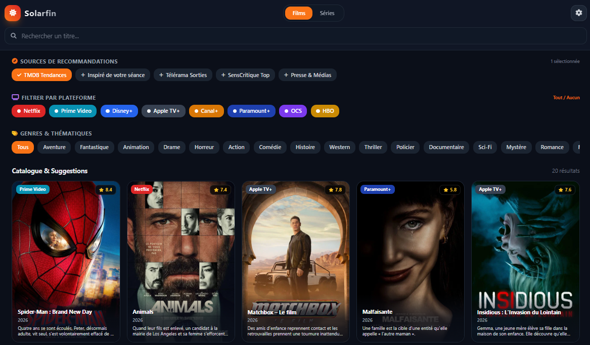

```markdown
# Solarfin 🎬

**Solarfin** est une Progressive Web App (PWA) légère et moderne conçue pour s'interfacer avec **Seer** (et vos instances **Radarr** / **Sonarr**). Elle permet de rechercher, consulter les détails et envoyer des demandes de films ou de séries de manière fluide, tout en contournant les contraintes CORS grâce à un reverse proxy Nginx intégré.

---

## 🚀 Fonctionnalités

- **Interface PWA responsive** : Conçue pour mobile et desktop avec un design sombre inspiré des grandes plateformes de streaming (Tailwind CSS).
- **Sélection dynamique des profils** : Récupère automatiquement vos profils de qualité et de langue configurés dans Seer/Radarr/Sonarr.
- **Contournement CORS natif** : Intégration d'un reverse proxy Nginx pour un échange fluide avec l'API Seer sans blocage du navigateur.
- **Mode hors-ligne / PWA** : Support du Service Worker (`sw.js`) pour une installation en tant qu'application sur mobile ou PC.

---

## 📁 Structure du Projet

Dans votre dossier `solarfin` (situé dans votre stack média), vous devez retrouver les fichiers suivants :

```text
solarfin/
├── index.html        # Application principale (UI et logique JS)
├── manifest.json     # Configuration de la PWA
├── sw.js             # Service Worker
├── Dockerfile        # Recette de construction de l'image Nginx
└── default.conf      # Configuration du serveur web et reverse proxy Nginx

```


Lancez ensuite la construction et le déploiement depuis le dossier de votre stack :

```bash
docker compose up -d --build solarfin

```

---

## 📸 Aperçu de l'application

*(Vous pouvez placer vos captures d'écran dans un sous-dossier `docs/` ou `assets/` et mettre à jour les chemins ci-dessous)*

| Page d'accueil / Recherche | Modale de détails & Profils |
| --- | --- |
| ** | *[portable.jpeg]* |

---

## ⚙️ Utilisation

1. Ouvrez l'application à l'adresse : `http://<IP_DE_VOTRE_SERVEUR>:8080`
2. Rendez-vous dans les paramètres de l'application pour renseigner l'URL de votre proxy local (`http://192.168.1.201:8080`) et votre clé API Seer.
3. Recherchez un média, sélectionnez vos profils de qualité/langue et envoyez la demande !

```

```
