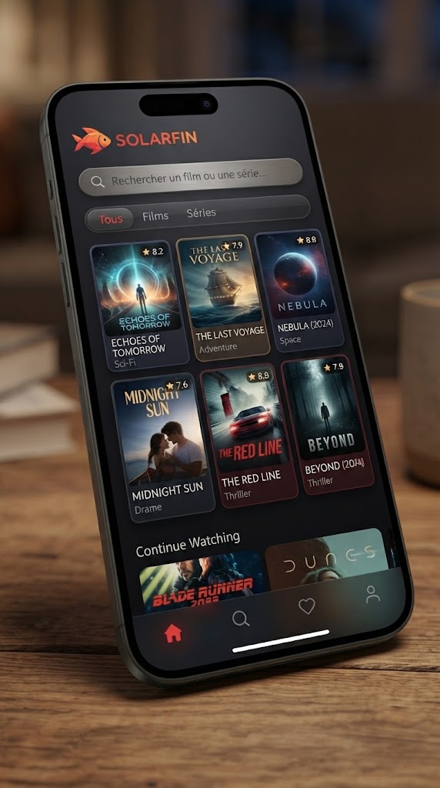

# Solarfin 🎬

**Solarfin** est une Progressive Web App (PWA) légère et moderne conçue pour s'interfacer avec **Seer** (et vos instances **Radarr** / **Sonarr**). Elle permet de rechercher, consulter les détails et envoyer des demandes de films ou de séries de manière fluide, tout en contournant les contraintes CORS grâce à un reverse proxy Nginx intégré.

---

## 🚀 Fonctionnalités

- **Interface PWA responsive** : Conçue pour mobile et desktop avec un design sombre inspiré des grandes plateformes de streaming (Tailwind CSS).
- **Sélection dynamique des profils** : Récupère automatiquement vos profils de qualité et de langue configurés dans Seer/Radarr/Sonarr.
- **Contournement CORS natif** : Intégration d'un reverse proxy Nginx pour un échange fluide avec l'API Seer sans blocage du navigateur.
- **Mode hors-ligne / PWA** : Support du Service Worker (`sw.js`) pour une installation en tant qu'application sur mobile ou PC.
- **Onglet Enfants** : Films classés par âge (3+, 6+, 9+, 12+), suivi « Déjà vu » / « J'aime » et recommandations basées sur les films aimés. Voir [docs/ONGLET_ENFANTS.md](./docs/ONGLET_ENFANTS.md).

---

## 📁 Structure du Projet

```text
solarfin/
├── index.html              # Application principale (UI et logique JS)
├── kids.js                 # Onglet Enfants : classification par âge, historique, recommandations
├── manifest.json           # Configuration de la PWA
├── sw.js                   # Service Worker
├── Dockerfile              # Recette de construction de l'image Nginx
├── default.conf.template   # Configuration du serveur web et reverse proxy Nginx
├── docker-compose.yml      # Lancement du conteneur
├── .env.example            # Modèle de configuration (à copier en .env)
├── docs/                   # Documentation technique (onglet Enfants)
└── tests/                  # Tests automatiques (node --test tests/)
```

Pour lancer les tests (Node.js 18 ou plus, aucune dépendance à installer) :

```bash
node --test tests/
```

---

## 🐳 Installation

1. Copiez le modèle de configuration et renseignez l'adresse de votre Seer :

   ```bash
   cp .env.example .env
   # puis éditez .env : SEER_URL=http://<IP_DE_VOTRE_SEER>:5055
   ```

   Le fichier `.env` est ignoré par Git : votre adresse ne sera jamais publiée.

2. Lancez la construction et le déploiement :

   ```bash
   docker compose up -d --build solarfin
   ```

   Si vous intégrez Solarfin à une stack existante (dossier `solarfin/` à côté de votre `docker-compose.yml`), remplacez `build: .` par `build: ./solarfin`.

---

## 📸 Aperçu de l'application

| Page d'accueil / Recherche | Version mobile (maquette) |
| --- | --- |
|  |  |

---

## ⚙️ Utilisation

1. Ouvrez l'application à l'adresse : `http://<IP_DE_VOTRE_SERVEUR>:8080`
2. Rendez-vous dans les paramètres de l'application pour renseigner votre clé TMDB, l'URL du proxy (`http://<IP_DE_VOTRE_SERVEUR>:8080`) et votre clé API Seer.
3. Recherchez un média, sélectionnez vos profils de qualité/langue et envoyez la demande !

---

## 🔒 Sécurité

- Les clés API sont stockées **uniquement dans le navigateur** (`localStorage`), avec un simple brouillage XOR : ce n'est **pas** un chiffrement. N'utilisez pas l'application sur un appareil partagé.
- La clé API Seer donne les droits **administrateur** sur Seer : n'exposez pas Solarfin sur Internet sans authentification devant (VPN, Tailscale, reverse proxy avec login…).
- Ne commitez jamais de clé API, d'adresse IP ou de fichier `.env` dans ce dépôt.

---

## 🙏 Crédits

Données et images fournies par [TMDB](https://www.themoviedb.org/). Ce produit utilise l'API TMDB mais n'est ni approuvé ni certifié par TMDB.
